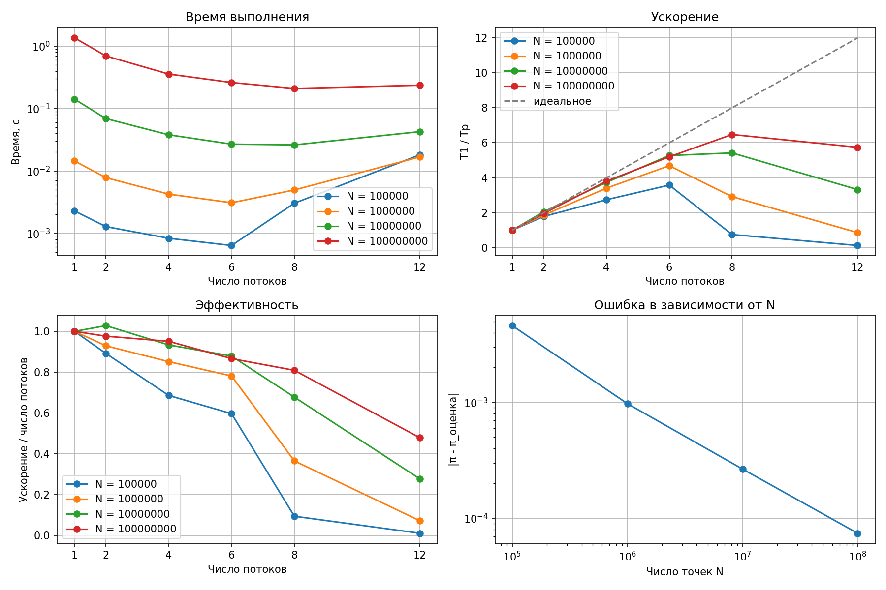
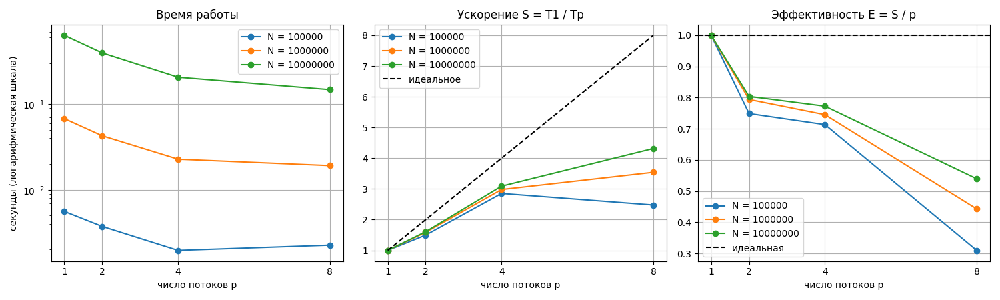

# Лабораторная работа № 2. Вычисление π с OpenMP

## Как работает программа

Генерируем `N` случайных точек в квадрате со стороной 2 и центром в начале координат. Если `x*x + y*y <= 1`, точка лежит в единичном круге. Площадь круга равна π, а площадь квадрата равна 4. Поэтому по числу попаданий `K` оцениваем π по формуле `4 * K / N`.

В `pi.c` директива `omp parallel` создаёт команду потоков, а `omp for` делит между ними итерации цикла. У каждого потока своё состояние генератора `rand_r`, начальное значение которого равно `12345 + номер_потока`. Директива `reduction(+:hits)` складывает счётчики попаданий, а `omp single` поручает одному потоку записать фактический размер команды.

## Сборка и запуск

В Linux или WSL соберите программу с GCC из папки проекта.

```bash
gcc -O2 -fopenmp pi.c -o pi -lm
./pi 1000000 4
```

В запуске скомпилированного файла первый аргумент — число случайных точек, второй — запрошенное число потоков. Оба аргумента должны быть положительными. 
В выводе `threads` — фактическое число потоков, `n` — число точек, `pi` — оценка π, `error` — абсолютная ошибка (насколько отличается от π), `time` — время расчёта в секундах. Таймер охватывает параллельную область, включая генерацию точек, подсчёт попаданий и объединение счётчиков.

## Методика замеров

Замеры проводились для разных значений `N` и числа потоков. В каждом режиме программу запускали пять раз и брали медиану времени. Ускорение считали по формуле `S(p) = T₁ / Tₚ`, где `T₁` — медиана времени на одном потоке, а `Tₚ` — на `p` потоках при том же `N`. Эффективность в процентах вычисляли как `S(p) / p × 100%`. Для графика точности использовали абсолютную ошибку однопоточного запуска при каждом `N`.

## Автоматические замеры

`benchmark.py` выполняет те же запуски автоматически. Ему нужны Python 3, Matplotlib и собранная программа `./pi`.

```bash
python3 benchmark.py
```

Скрипт измеряет четыре размера от 100 тыс. до 100 млн точек на 1, 2, 4, 6, 8 и 12 потоках. Для каждой пары `N` и числа потоков он делает пять запусков и берёт медиану. Набор точек, число потоков и число повторов можно задать в списках `POINTS`, `THREADS` и переменной `REPEATS` в начале файла. Оставьте `1` первым элементом `THREADS`, чтобы скрипт получил базовое время.

При каждом запуске скрипт перезаписывает `results.csv` и `plots.png` в текущей папке. Если он предупреждает, что фактическое число потоков меньше запрошенного, подберите значения `THREADS` под вашу среду и повторите эксперимент. В CSV и при расчёте эффективности скрипт использует запрошенное число потоков.

## Результаты

Сохранённые замеры выполнены под WSL2 на Intel Core i5-12450H с 12 логическими процессорами. Для этих замеров указан GCC 11.4.0 с оптимизацией `-O2`. В таблице для каждого размера указан самый быстрый из измеренных режимов. [Полная таблица замеров](results.csv)

| Число точек | Время на 1 потоке, мс | Потоки в самом быстром режиме | Время, мс | Ускорение | Эффективность |
| ---: | ---: | ---: | ---: | ---: | ---: |
| 100 000 | 2,277 | 6 | 0,636 | 3,58× | 59,7% |
| 1 000 000 | 14,448 | 6 | 3,082 | 4,69× | 78,1% |
| 10 000 000 | 141,697 | 8 | 26,139 | 5,42× | 67,8% |
| 100 000 000 | 1361,496 | 8 | 210,352 | 6,47× | 80,9% |



Для 100 тыс. точек шесть потоков дали 0,636 мс, а двенадцать — 18,148 мс. На таком объёме работы заметны затраты на запуск и синхронизацию потоков. Для 100 млн точек максимальное измеренное ускорение составило 6,47 раза на восьми потоках. В однопоточных запусках абсолютная ошибка снизилась с 0,00459 до 0,0000742 при увеличении числа точек со 100 тыс. до 100 млн.

# Задание 2. Параллельный алгоритм Препараты–Хонга

## Задание

Реализовать параллельный алгоритм Препараты–Хонга построения выпуклой оболочки точек на плоскости с использованием OpenMP.

- Формат ввода: в первой строке натуральное число N (до 100 миллионов) — количество точек, далее N строк, в каждой пара координат `x y`.
- Формат вывода: в первой строке количество вершин выпуклой оболочки, далее в каждой строке пара координат вершины. Вершины следуют в порядке обхода против часовой стрелки, начиная с любой вершины.
- Организовать визуализацию результата, которая демонстрирует корректность реализации.
- Построить графики времени выполнения, ускорения и эффективности, исследовать зависимость от входных данных.

Считаем, что все точки уникальные.

## Файлы

| Файл | Назначение |
|---|---|
| `hull.c` | алгоритм Препараты–Хонга на C с OpenMP |
| `gen.py` | генерация входного файла со случайными точками |
| `visualize.py` | картинка: исходные точки и построенная оболочка |
| `bench.sh` | замеры времени на разном количестве точек и потоков, картинки и сверка ответов |
| `plot.py` | графики времени, ускорения и эффективности |

## Решение

### Идея алгоритма

Алгоритм Препараты–Хонга строит выпуклую оболочку по принципу «разделяй и властвуй».

1. Точки сортируются по x, при равных x — по y (`qsort`).
2. Если точек 1, 2 или 3, оболочка строится напрямую. Для трёх точек порядок обхода против часовой стрелки определяется знаком векторного произведения; если точки на одной прямой, оболочка — отрезок между крайними.
3. Иначе множество делится пополам вертикальной прямой `x = x_median`: первые `n/2` отсортированных точек слева, остальные справа. Оболочки левой половины L и правой половины R строятся рекурсивно.
4. Оболочки L и R склеиваются. Для этого ищутся верхняя и нижняя общие опорные прямые: прямые через вершину L и вершину R, такие что оба многоугольника лежат по одну сторону от прямой. Оболочка объединения — вершины L от `l_top` до `l_bottom` и вершины R от `r_bottom` до `r_top` в порядке обхода против часовой стрелки. Остальные вершины оказываются внутри и отбрасываются.

### Векторное произведение

Все геометрические проверки сводятся к одной функции:

```c
double cross(point a, point b, point c) {
    return (b.x - a.x) * (c.y - a.y) - (b.y - a.y) * (c.x - a.x);
}
```

Её значение равно `|ab| · |ac| · sin θ`, где θ — угол поворота от вектора a→b к вектору a→c. Знак показывает, с какой стороны от прямой a→b лежит точка c:

- `cross > 0` — слева, поворот a→b→c против часовой стрелки;
- `cross < 0` — справа, поворот по часовой стрелке;
- `cross = 0` — точки на одной прямой.

Углы и тригонометрические функции не вычисляются, поэтому проверки быстрые и точные.

### Поиск опорных прямых

Оболочки хранятся массивом вершин против часовой стрелки, первой идёт самая левая вершина. Поиск верхней опорной прямой:

1. Стартуем с отрезка «самая правая вершина L — самая левая вершина R». Самая левая вершина R — это `R[0]`, самая правая вершина L ищется перебором.
2. Если соседняя вершина L по верхней части многоугольника (`next`) лежит над прямой, переносим конец прямой на неё.
3. Если соседняя вершина R по верхней части (`prev`) лежит над прямой, переносим конец прямой на неё.
4. Повторяем, пока ни один конец не сдвигается.

Нижняя опорная прямая ищется так же, в противоположную сторону. Если соседняя вершина лежит ровно на прямой, переходим к ней, только когда она дальше от другого многоугольника. Поэтому точки, лежащие на сторонах оболочки, вершинами не считаются.

### Распараллеливание

Оболочки левой и правой половин строятся независимо, поэтому рекурсивные вызовы выполняются в отдельных тасках OpenMP:

```c
#pragma omp task shared(nl) if(n > 10000)
    nl = build_hull(p, mid, h);
#pragma omp task shared(nr) if(n > 10000)
    nr = build_hull(p + mid, n - mid, h + mid);
#pragma omp taskwait
    return merge_hulls(h, nl, mid, nr);
```

- `task` — рекурсивный вызов становится задачей, которую выполнит первый освободившийся поток.
- `shared(nl)`, `shared(nr)` — результат таски записывается в переменную родителя. Без `shared` таска писала бы в свою приватную копию.
- `if(n > 10000)` — таски создаются только для больших подзадач. Маленькие подзадачи выполняются сразу текущим потоком: создание таски для них дороже самой работы. Порог подобран эмпирически.
- `taskwait` — склейка начинается только после того, как готовы обе половины.

Рекурсия запускается одним потоком внутри параллельной области, остальные потоки разбирают таски:

```c
#pragma omp parallel num_threads(thread_count)
#pragma omp single
    count = build_hull(p, n, h);
```

Гонок нет, поэтому `critical`, `atomic` и замки не нужны. Левая половина записывает свою оболочку в `h[0..mid)`, правая — в `h[mid..n)`. Оболочка k точек содержит не больше k вершин, поэтому участки массива не пересекаются.

### Сложность

- Сортировка: O(N log N).
- Глубина рекурсии: log₂N уровней, для 100 млн точек около 27.
- На каждом уровне склейки суммарно обрабатывают не больше N вершин.

Итого O(N log N).

## Как запускать на Mac

### Установка, один раз

Apple clang не поддерживает OpenMP без отдельной библиотеки:

```bash
brew install libomp
```

Для визуализации и графиков нужен matplotlib:

```bash
python3 -m pip install --user matplotlib
```

### Сборка

```bash
clang -O2 -ffp-contract=off -Xpreprocessor -fopenmp -I$(brew --prefix libomp)/include -L$(brew --prefix libomp)/lib -lomp hull.c -o hull
```

На Linux:

```bash
gcc -O2 -fopenmp -ffp-contract=off hull.c -o hull
```

Флаг `-ffp-contract=off` обязателен. Без него компилятор может объединить `a*b - c*d` из `cross` в одну FMA-инструкцию, и для точки, лежащей на прямой, вместо нуля получится маленькое ненулевое число. Тогда алгоритм ошибается на точках, лежащих на одной прямой.

### Один запуск

```bash
python3 gen.py 1000 > points.txt
```

```bash
./hull 4 < points.txt > hull.txt
```

```bash
python3 visualize.py points.txt hull.txt
```

- `./hull 4` — 4 потока. Точки читаются со стандартного ввода (`< points.txt`), ответ печатается в стандартный вывод (`> hull.txt`).
- В stderr, на экран, выводятся два числа в секундах: время сортировки и время параллельного построения оболочки.
- `visualize.py` открывает окно с картинкой и сохраняет её в `hull.png`.

### Замеры, картинки и графики

```bash
./bench.sh > results.txt
```

```bash
python3 plot.py results.txt
```

```bash
open pictures
```

`bench.sh` перебирает количество точек `sizes=(100000 1000000 10000000)` и число потоков `threads=(1 2 4 8)`. Для каждой пары он:

1. генерирует файл точек `points_N.txt`, один раз на каждое N;
2. запускает `hull` и печатает строку `N потоки время_сортировки время_оболочки`;
3. сохраняет ответ в `pictures/hull_N_T.txt` и картинку в `pictures/hull_N_T.png`;
4. сравнивает ответ с ответом на 1 потоке и при расхождении печатает `ОШИБКА`.

`plot.py` строит три графика по времени параллельной части и сохраняет их в `graphs.png`.

Размеры и число потоков меняются в начале `bench.sh`. Число ядер можно узнать командой:

```bash
sysctl -n hw.ncpu
```

## Проверка корректности

Корректность проверяется двумя способами.

1. Картинки в `pictures/`. Оболочка правильная, если все серые точки внутри красного многоугольника или на его границе, многоугольник выпуклый, вершины совпадают с исходными точками и на прямых сторонах нет лишних вершин.
2. Сверка в `bench.sh`. Ответ на 2, 4 и 8 потоках должен совпадать с ответом на 1 потоке. Это показывает, что распараллеливание не портит результат.

## Ускорение и эффективность

### Определения

- T₁ — время на 1 потоке, Tₚ — время на p потоках.
- Ускорение S = T₁ / Tₚ. Идеал S = p.
- Эффективность E = S / p. Идеал E = 1.

Считаются по времени параллельной части, без сортировки: это последняя колонка `results.txt`.

### Результаты замеров

Замеры сделаны на Mac с 8 ядрами командой `./bench.sh > results.txt`. Содержимое `results.txt`, колонки: N, потоки, время сортировки, время параллельной части в секундах:

```
100000 1 0.007565 0.005595
100000 2 0.007991 0.003736
100000 4 0.007712 0.001961
100000 8 0.007859 0.002259
1000000 1 0.096434 0.067920
1000000 2 0.092850 0.042770
1000000 4 0.094123 0.022787
1000000 8 0.096033 0.019178
10000000 1 1.148427 0.638523
10000000 2 1.103946 0.397130
10000000 4 1.110365 0.206651
10000000 8 1.104050 0.147949
```

Ускорение и эффективность параллельной части. T — время параллельной части:

| N | p | T, с | S = T₁ / Tₚ | E = S / p |
|---|---|---|---|---|
| 100 000 | 1 | 0,005595 | 1,00 | 1,00 |
| 100 000 | 2 | 0,003736 | 1,50 | 0,75 |
| 100 000 | 4 | 0,001961 | 2,85 | 0,71 |
| 100 000 | 8 | 0,002259 | 2,48 | 0,31 |
| 1 000 000 | 1 | 0,067920 | 1,00 | 1,00 |
| 1 000 000 | 2 | 0,042770 | 1,59 | 0,79 |
| 1 000 000 | 4 | 0,022787 | 2,98 | 0,75 |
| 1 000 000 | 8 | 0,019178 | 3,54 | 0,44 |
| 10 000 000 | 1 | 0,638523 | 1,00 | 1,00 |
| 10 000 000 | 2 | 0,397130 | 1,61 | 0,80 |
| 10 000 000 | 4 | 0,206651 | 3,09 | 0,77 |
| 10 000 000 | 8 | 0,147949 | 4,32 | 0,54 |

Ускорение всей работы алгоритма: сортировка вместе с параллельной частью.

| N | доля сортировки на 1 потоке | S на 2 потоках | S на 4 потоках | S на 8 потоках |
|---|---|---|---|---|
| 100 000 | 0,57 | 1,12 | 1,36 | 1,30 |
| 1 000 000 | 0,59 | 1,21 | 1,41 | 1,43 |
| 10 000 000 | 0,64 | 1,19 | 1,36 | 1,43 |

### Графики

Графики построены командой `python3 plot.py results.txt` по времени параллельной части.



**Время работы** (левый график, ось времени логарифмическая, чтобы все три N поместились на одном графике). Для 1 млн и 10 млн точек время монотонно уменьшается с ростом числа потоков: линии идут вниз на всём диапазоне. Спад от 1 до 4 потоков крутой, от 4 до 8 — заметно положе. Для 100 тыс. точек линия после 4 потоков идёт вверх: на 8 потоках программа медленнее, чем на 4.

**Ускорение** (средний график). Пунктир — идеальное ускорение S = p. До 4 потоков все три линии идут почти вместе и растут почти линейно, но ниже идеала: на 2 потоках S ≈ 1,5–1,6 при идеальных 2, на 4 потоках S ≈ 2,85–3,09 при идеальных 4. После 4 потоков линии расходятся. Для 10 млн точек ускорение продолжает расти до 4,32, для 1 млн — до 3,54, а для 100 тыс. — падает до 2,48. Чем больше N, тем выше линия: зависимость от входных данных видна прямо на графике.

**Эффективность** (правый график). Пунктир — идеальная эффективность E = 1. Эффективность падает с ростом числа потоков для всех N, это ожидаемо. На 2 и 4 потоках она держится на уровне 0,71–0,80. При переходе к 8 потокам она резко падает: до 0,54 для 10 млн, 0,44 для 1 млн и 0,31 для 100 тыс. точек. Линия большего N везде лежит выше: на больших данных потоки загружены полезной работой лучше.

Итог по графикам: алгоритм хорошо масштабируется до 4 потоков, а дальше выигрыш от новых потоков есть только на больших данных и меньше идеального. Причины разобраны в выводах ниже.

### Выводы

1. Распараллеливание работает. На 10 млн точек параллельная часть на 8 потоках выполняется в 4,32 раза быстрее, чем на одном: 0,148 с против 0,639 с. Корректность подтверждается тем, что `bench.sh` не вывел сообщений `ОШИБКА` (ответы на всех числах потоков совпали с ответом на 1 потоке), и картинками в `pictures/`.
2. Ускорение растёт с ростом N. На 8 потоках оно равно 2,48 при 100 тыс. точек, 3,54 при 1 млн и 4,32 при 10 млн, эффективность — 0,31, 0,44 и 0,54 соответственно. Чем больше точек, тем больше работы приходится на каждую таску и тем меньше относительный вклад накладных расходов. Это совпадает с теоретической оценкой.
3. При 100 тыс. точек 8 потоков работают медленнее 4: 0,00226 с против 0,00196 с. Тасок при таком N всего 30, а работы на поток — доли миллисекунды, поэтому создание потоков и распределение тасок съедают выигрыш. Для малых N больше 4 потоков использовать невыгодно.
4. До 4 потоков эффективность держится на уровне 0,71–0,80, а при переходе к 8 потокам падает до 0,31–0,54: для 1 и 10 млн точек время от 4 к 8 потокам уменьшается лишь в 1,2–1,4 раза вместо 2. Возможные причины:
   - конкуренция потоков за системный аллокатор: каждая склейка вызывает `malloc` и `free`;
   - склейки верхних уровней выполняются последовательно, одним потоком;
   - на процессорах Apple Silicon часть ядер энергоэффективные и работают медленнее производительных; если производительных ядер 4, потоки сверх 4 попадают на медленные ядра.
5. Ускорение на 2 потоках около 1,5–1,6, а не 2. Часть времени уходит на последовательные склейки верхних уровней и на создание тасок, а при двух потоках эта доля заметнее всего.
6. Всю программу ограничивает последовательная сортировка `qsort`: она занимает 57–64 % времени алгоритма на одном потоке. По закону Амдала при доле s = 0,64 ускорение на 8 потоках не может превысить 1 / (0,64 + 0,36 / 8) ≈ 1,46, и измеренное значение 1,43 близко к этой границе. Чтобы ускорить программу целиком, нужно распараллелить и сортировку, например параллельной сортировкой слиянием на тех же тасках.

